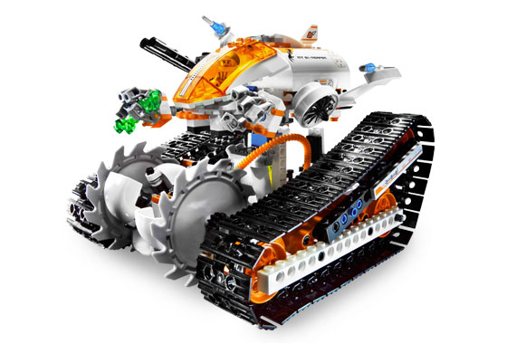
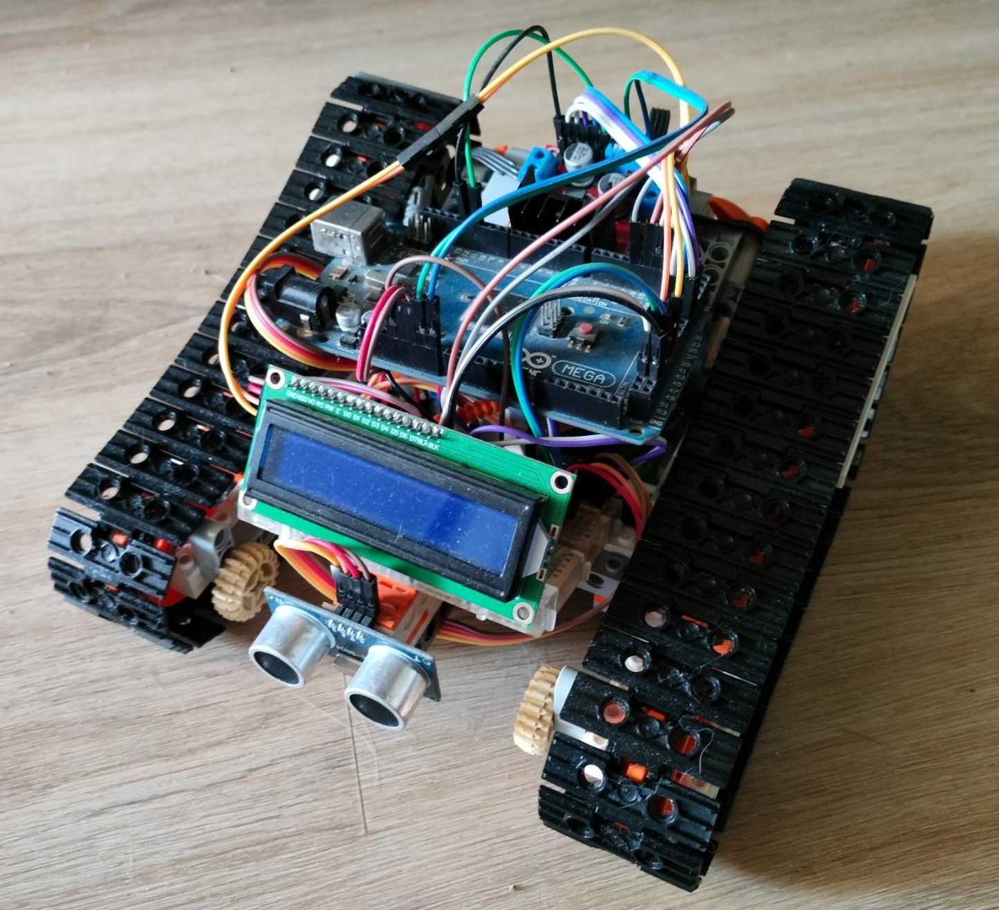
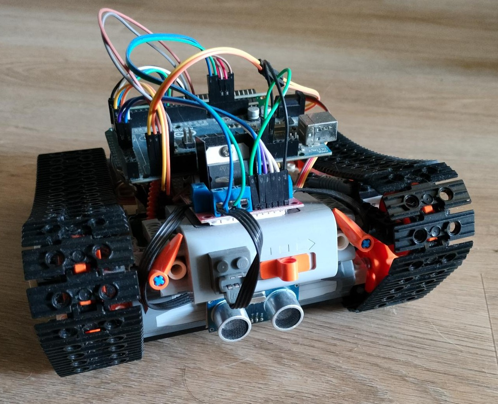

# The Crystal Reaper Bluetooth Controlled Robot

This project uses the Lego Mars Mission 7645 MT-61 Crystal Reaper Lego set as a basis to build a bluetooth controlled robot. It uses two Lego power functions DC motors and a battery pack to be able to drive. An Arduino Mega is used to connect everything together and to program it via the Arduino IDE. Read on to learn how you can make one yourself!

<table>
    <tr>
        <td align="center">
            
        </td>
        <td align="center">
            
        </td>
    </tr>
</table>

## Used parts

For this project I used off-the-shelf components that you can pick up for a reasonable price. The Arduino Mega got more expensive than when I bought it (I could pick it up for €20 if I remember correctly), but for this there are plenty of alternatives. You could for example also use an Uno, or maybe an ESP32 based board, that you can pick up for €10 I think. For the other components, keep in mind that buying stuff from China will cost you extra nowadays on income taxes.

The components used are the following:

* Arduino Mega 2560
* L298N dual DC motor controller
* HC SR04 ultrasonic distance sensors (2x)
* 1602 LCD screen + I2C interface module
* HM-10 Bluetooth module

And the Lego power functions used are:

* 8881 AA Battery box
* 8883 M DC Motor (2x)
* 8884 infrared receiver module

The infrared receiver you will not strictly need, but you will need the connection brick attached to it, to be able to connect the motor controller to the battery box. I bought the whole set, including an 8885 infrared remote control module, when first building this, so I already had it, but you might be able to directly solder wires on the battery box. I have not tried this, so I have no clue if this is doable...

## Assembly

For the assembly I have two tips. First, if you don't want to drill in lego bricks, or glue anything on them, use **double-sided tape**! For me this worked surprisingly well to attach PCBs to lego surfaces. If you decide later on that you want to build it differently you can change it really easily. And second, if you're building a prototype robot like this, try to avoid soldering if you can, and use a **breadboard** instead. I connected most of my wiring that way. Breadboards are really cheap and perfect for prototyping, in combination with some Dupont wires. As long as you are not using it for any high speed stuff (anything below 1 MHz should not be a problem) it's quite robust. When you want to make a more permanent design later on, you can do PCB design and soldering then.

## Result

Below are two pictures of my finished prototype. As you can see it has quite a wild haircut with all the wiring sticking out. I removed the entire top section of the lego set to make room for all the electronic components.

<table>
    <tr>
        <td align="center">
            
        </td>
        <td align="center">
            
        </td>
    </tr>
</table>

As you can see the two ultrasonic sensors are placed on the front and rear for obstacle detection. In this way you can think of an algorithm for the robot to drive a certain route without hitting anything in your living room :) Of course just those two sensors are quite limited for a more advanced navigation algorithm, but they are really cheap, easy to use and they are quite accurate with their distance calculation, so you can do some fun stuff with them. More sensors can always be added later.

Not so well visible on those pictures are the breadboard and the bluetooth module. The breadboard is behind the screen (the screen is showing the outputs of the distance sensors), and the bluetooth module is between the battery box and the breadboard. On the breadboard is only a level shifter for the bluetooth module for now, but there's room to add other circuits later.

## Bluetooth control

For making the robot controllable with a smartphone, I used the *Serial Bluetooth Terminal* app. This is a free app to send and receive simple characters or strings of characters to and from other bluetooth devices. I think there are more advanced bluetooth apps out there that already give you a nice UI on your smartphone, and a ready to use library in the Arduino IDE. This might be interesting if you want something that quickly works, but if you want to learn a bit more about bluetooth and how sending and receiving data over UART works, it may be worth it to write the code yourself.

I implemented commands for manual and autonomous mode. In the autonomous mode the robot will drive around and find its own way, while trying to avoid all obstacles. For now it doesn't really have a goal, so it will drive around a bit aimlessly. You can see it as a rather stupid pet, trying to look for food.
In the manual mode you can use the robot like an RC car, and drive it yourself with four simple commands: Forward, Backward, Left and Right. Use it to scare your cats, or to transport some snacks for example :)

## Why lego?

For this specific project because I already had this lego set with power functions, but I thought the remote looked rather lame and it would be a lot cooler to control it from a smartphone.

In general, because Lego bricks are actually really nice prototyping material. If you want to add a sensor but don't have a good mounting point: just build it with some lego bricks. If you want to add a mechanical component, just prototype something with spare bricks, or design something in Lego studio. If you don't like the design just build something different and start over. It's a great alternative for 3D printing I think.

## Possible upgrades

* Put an inductive or capacitive sensor at the bottom for detecting metal objects like coins
* Add an amplifier circuit + speaker on the breadboard for playing sounds
* Design a PCB with only the necessary components on it, so that it all fits in the interior of the Crystal Reaper, and the the top part of the Lego set can be placed on top
* Add infrared sensors on the bottom so the robot can follow lines on the floor
* Make the algorithm more complex, so that the robot can remember where all the obstacles are, and find the quickest path to a destination
* Add rubber pieces in the tracks so the robot has more traction on a smooth floor
* Find a good way to integrate the small LCD screen (for now it's not attached to anything)
* Anything else you think is cool to add...
